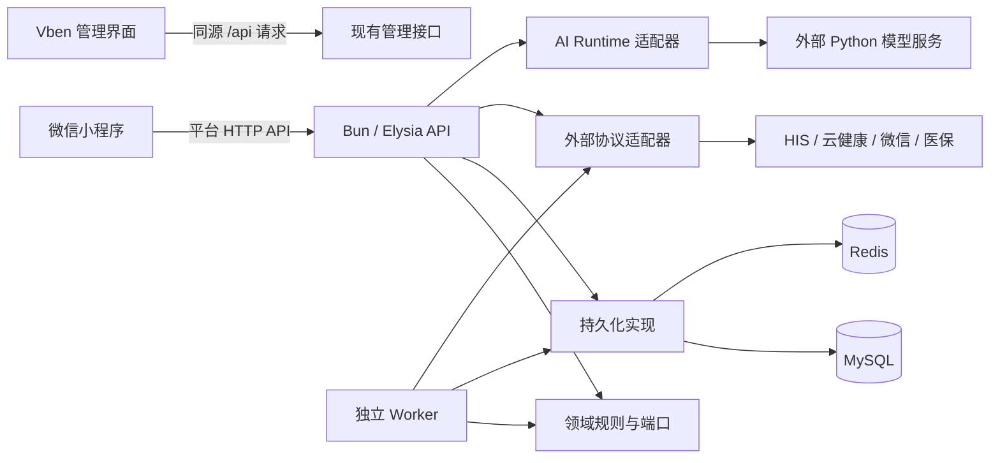

# 系统设计与整理基线

> 整理基线：2026-10-28，提交 `30fc7015`，另明确记录本轮管理端退役边界。本文核对源码、workspace 配置和构建入口；原工作区未提交的业务改动不纳入此基线。本文描述源码架构和后续设计，不声明线上版本、Provider 可用性或真机验收结果。

## 1. 架构结论

保留当前的模块化单体 API、独立 Worker、原生微信小程序，以及 Admin 2 前端和现有管理接口的边界。项目已经具备 `apps/` 与 `packages/` 的基本分层；整理重点是厘清业务所有权、缩小聚合文件、统一跨入口的业务规则，并把开发、运维、历史证据和本地材料分开管理。

当前没有充分的代码证据支持按业务域拆成多个网络服务。后续先在同一部署单元内拆分职责，保持 HTTP 契约、数据库事务、幂等键、订单关联和发布回滚边界稳定。

## 2. 应用边界与本轮管理端收敛

| 单元 | 源码职责 | 构建与启动事实 | 整理约束 |
| --- | --- | --- | --- |
| `apps/api` | Elysia 路由、鉴权、应用服务、运行组合根 | `src/index.ts` 组装依赖并启动；`src/app.ts` 注册路由；`src/application.ts` 组装应用服务 | 不能把路由已注册解释为运行 gate 已开放 |
| `apps/worker` | Outbox、微信支付/医保查单、退款通知与补偿 | `src/index.ts` 启动循环，`src/runtime.ts` 创建依赖并执行数据库/schema 探针 | 独立进程；是否在线运行须另查部署证据 |
| `apps/miniprogram` | 原生 WXML/WXSS/TypeScript 患者端 | 基线 `src/app.json` 注册 55 个页面；运行入口由构建生成在 `dist/` | `src/` 是源，`dist/` 是带来源校验的运行包；禁止把测试脚本带入运行包 |
| `apps/admin2` | 保留官方核心的 Vben `web-antd` 管理界面及其已有医院业务 | 根 workspace 显式排除它；内部有独立 pnpm workspace、锁文件和工具入口 | 保持现有 Admin 2 能力；退役旧 Admin 不增加已删除的日志查询或其他旧功能 |

基线提交中，`apps/admin` 同时含旧 React 客户端与 Bun 服务，Admin 2 的打包脚本仍引用 `../admin/src/server.ts`。这项源码构建耦合不能证明旧服务中的功能应保留、迁入或重新开放。本轮按现有 Admin 2 的能力边界退役旧 Admin；日志查询按用户明确要求保持删除，不能通过复制旧服务恢复。构建残留依赖应单独做最窄修正，不能扩成恢复旧后台的工程。

`apps/admin2/UPSTREAM.json` 记录 Vben 上游核心的校验范围。内部包和工具仍应先对照构建与来源校验，再决定去留；管理接口真实运行来源不能仅凭旧打包脚本推断。

源码依据：[API 入口](../../apps/api/src/index.ts)、[应用服务组装](../../apps/api/src/application.ts)、[Worker 入口](../../apps/worker/src/index.ts)、[Worker 运行时](../../apps/worker/src/runtime.ts)、[小程序页面注册](../../apps/miniprogram/src/app.json)、[Admin 2 构建](../../apps/admin2/tools/build.mjs)、[主 workspace](../../pnpm-workspace.yaml)。

### Admin 2 的现有能力与构建残留

基线中只有 `router/routes/modules/hospital.ts` 被作为业务动态路由加载。现有页面是支付记录、支付调用链、同步任务，以及隐藏菜单中的支付账本、账号信息；上游 demo/dashboard 文件存在不等于业务路由已启用。

`hospital/retired-page-state.ts` 明确登记 `/hospital/logs`（`HospitalLogs`）和旧 `/hospital/payments/simple` 为退役页面；启动时清除它们的持久化页签和搜索历史。日志列表、详情、原文三个 `fetchLog*` 函数仍留在 API 文件中，但基线的业务页面没有调用它们，不能据此恢复日志查询。支付调用链页原有的 `fetchPaymentDay`、`fetchPaymentInterface` 调用是另一条现有业务链，不能与已经删除的实时日志页混为一谈。

医院业务通过 `hospital/api.ts` 的原生 `fetch` 访问同源 `/api/...`，使用 tab 范围的 `hospital.admin2.session` 和 Bearer token；医院登录、用户信息和路由守卫复用该会话。开发配置把 `/api` 代理到现有管理域名。Vben 的通用请求客户端并不是医院业务请求的主要入口，不能只看 `api/request.ts` 推断实际链路。

基线 `tools/build.mjs` 在构建 Vben 客户端后又打包旧 `apps/admin/src/server.ts`，根 `admin2:start` 也指向该打包结果。这是需要清除的旧打包来源，不能转化为新增 `admin2/server`、迁回日志 handler 或重建已删除页面的依据。退役旧 Admin 的最窄方向是保持既有客户端、请求和鉴权链，只修正客户端交付与遗留启动/说明入口；本轮未验证线上管理接口由哪个部署资产承载。

依据：[当前业务路由](../../apps/admin2/apps/web-antd/src/router/routes/modules/hospital.ts)、[路由加载范围](../../apps/admin2/apps/web-antd/src/router/routes/index.ts)、[退役页面状态](../../apps/admin2/apps/web-antd/src/hospital/retired-page-state.ts)、[医院 API 客户端](../../apps/admin2/apps/web-antd/src/hospital/api.ts)、[开发请求代理](../../apps/admin2/apps/web-antd/vite.config.ts)。

## 3. 当前运行关系

下图表达已核对的源码职责和客户端请求边界。Admin 2 的管理接口实际部署来源尚未在本轮核实，不由旧服务端源码推断；图中其他外部能力也不表示已经启用。



Admin 2 客户端的现有路由、实际请求和鉴权链是整理依据。客户端 API 文件中保留一个函数，不等于现行页面仍调用它；旧服务存在一个接口，也不等于 Admin 2 应恢复对应功能。小程序只使用平台契约；已有固定 H5、医保授权等外部入口由各自的导航校验负责，不能借整理放宽为任意跳转。

### 业务请求经过哪些边界

1. HTTP 路由负责认证、输入 schema、错误映射和响应契约。
2. 应用服务负责 owner 范围、跨仓储/Provider 的用例编排、权限和失败恢复。
3. 领域层负责状态转换、金额不变量、幂等语义及仓储/外部能力端口。
4. 持久化实现负责 SQL、事务、版本更新、唯一键、加密事实及任务领取。
5. Adapter 负责外部协议、签名/验签、字段解析、超时与传输错误；外部 HTTP 成功不能直接作为业务成功。
6. Worker 消费持久化任务并恢复未知结果，不用进程内循环代替订单状态和租约事实。

现有实现并非所有服务都已经完全符合这一目标划分。尤其是 API 组合根、支付服务和仓储工厂仍承担较多跨域工作，下文按风险安排拆分。

## 4. 当前共享包依赖

表中的箭头表示“本包依赖的其他项目包”，依据各包 `package.json` 和关键源码导入核对。

| 包 | 当前项目内依赖 | 应保留的职责 |
| --- | --- | --- |
| `contracts` | 无 | 公共 schema、API 载荷、稳定错误/状态类型及客户端共享的纯规则 |
| `domain` | `contracts` | 领域状态机、纯校验、端口；不导入 Adapter 或具体数据库实现 |
| `adapters` | `contracts`、`domain` | 众阳、云健康、微信、医保等外部协议；Java FSI SDK 也是此边界的一部分 |
| `persistence` | `contracts`、`domain`、`observability` | MySQL/Redis 实现、迁移、只读探针、仓储和加密事实 |
| `ai-runtime` | `domain` | 外部模型/语音/知识服务的端口实现 |
| `config` | 无 | 服务端环境解析、运行配置与各能力 gate |
| `observability` | 无 | Pino 入口、事件元数据、脱敏与日志转发 |

当前 `domain → contracts` 是既有依赖，不能在设计图中画成相反方向。`API/Worker → persistence/adapters` 由各自组合根完成。基线中没有确认到 Worker 导入 API 源码的跨应用依赖。

`adapters/src/http.ts` 接受结构化日志端口，避免反向导入 `observability`；不过默认 logger 是模块级配置，后续改为每个 client 显式注入时，需要先验证测试隔离和并发行为。

## 5. 业务域所有权

API 当前有 20 个模块目录。可按下列业务组理解和维护；这些分组是职责图，不要求为每组新建 package 或服务。

| 业务组 | 当前模块 | 应拥有的规则 |
| --- | --- | --- |
| 账户与就诊人 | `auth`、`profile`、`patients` | 平台会话、普通资料、owner 与就诊人关联；医院身份映射留在服务端 |
| 预约与医生关系 | `appointments`、`my-doctors` | 科室/排班/预约、取消及医生关系；预约与支付互斥规则需显式协调 |
| 支付与结算 | `payments`、`medical-insurance`、`outpatient-payments`、`his` 及 Admin 的退款能力 | 自费、医保、混合支付、HIS 关联、查询/回调/退款和未知状态恢复 |
| 临床读模型 | `reports`、`medical-records`、`inpatient`、`outpatient-invoices` | 患者范围、目录/详情引用、外部资源和各能力独立 gate |
| 内容与交流 | `knowledge`、`intelligent-guide`、`intelligent-customer`、`patient-feedback` | 内容准入、会话归属、导诊/客服编排和反馈记录 |
| 运行与管理 | `health`、`system`、`admin` | 存活/就绪、运行元数据、管理鉴权和操作审计 |

支付组不应被当作一个可以随意抽取的通用 `utils`。预约锁、支付金额、Provider 关联号和退款终态属于同一条业务证据链；拆分文件时仍须保留用例层的显式协调。

## 6. 已确认的整理重点

行数按基线提交的源码文本统计，仅用于定位维护热点，不是单独的质量结论。

| 优先级 | 证据 | 设计动作 | 验收重点 |
| --- | --- | --- | --- |
| 第一批 | API `application.ts` 1,237 行，入口 `index.ts` 1,101 行，Worker `runtime.ts` 998 行 | 将进程生命周期、外部依赖创建、业务服务组装分开；按业务组提供小型工厂 | 默认关闭、schema gate、依赖探针、stop/close 和注册路由保持一致 |
| 第一批 | `mysql-repositories.ts` 7,860 行，`repositories.ts` 3,480 行 | 按账户、就诊人、预约、支付、医保、任务等域拆仓储工厂，保留统一组装入口 | 订单与 Outbox 同事务、owner 条件、唯一键、版本条件和锁使用同一连接 |
| 第一批 | API 与 Worker 都有 `resolveRegistrationSelfPayContext`；API 优先读取普通自费上下文，Worker 基线实现从医保上下文解析 | 先给两种入口补充能够表达差异的特征测试，再决定哪些规则共享、哪些差异必须保留 | 普通自费/医保/历史插件、owner 校验、缺失关联、未知结果及加密上下文；当前差异尚未验证为运行故障 |
| 第二批 | `legacy-fsi-medical-insurance.ts` 4,794 行，微信 Adapter 2,563 行，云健康结算 Adapter 2,145 行 | 每个 Provider 内按传输、签名、请求/响应合同及业务能力分文件 | 原文保真、签名输入、错误/未知态与重试边界不变，保留 Java SDK 所需文件 |
| 第二批 | 小程序 `api-client.ts` 4,617 行，`dashboard-service.ts` 2,423 行 | 拆传输/会话、各域 endpoint 和 DTO 解释；继续提供现有 facade | 会话代际、旧响应隔离、请求超时、错误语义和支付继续查询 |
| 第二批 | `contracts/src/index.ts` 1,893 行，`config/src/index.ts` 1,432 行 | 按业务域/能力分文件，根导出保持兼容 | API 输入输出、客户端类型、env 名称、默认值与 gate 全部保持稳定 |
| 本轮退役 | 基线 Admin 2 打包脚本仍引用旧 Admin 的 Bun 服务 | 按现有 Admin 2 能力退役 `apps/admin`，只修正遗留构建引用；不复制旧服务恢复已删除功能 | Admin 2 现有路由/请求/鉴权边界保持一致；日志查询不被重新引入 |

源码证据：[MySQL 仓储工厂](../../packages/persistence/src/mysql-repositories.ts)、[仓储集合](../../packages/persistence/src/repositories.ts)、[医保 Adapter](../../packages/adapters/src/legacy-fsi-medical-insurance.ts)、[小程序 API 客户端](../../apps/miniprogram/src/services/api-client.ts)、[小程序聚合服务](../../apps/miniprogram/src/services/dashboard-service.ts)、[公共契约](../../packages/contracts/src/index.ts)、[运行配置](../../packages/config/src/index.ts)。

### 共享代码的提取原则

纯状态规则、金额/标识规范化放在对应领域模块；SQL 和加解密落库能力放在 `persistence`；Provider 字段/签名转换放在对应 Adapter。读取多个仓储并协调 Provider 的代码属于应用编排，不能因为 API 和 Worker 都调用它就塞进领域工具文件。

确实被多个进程复用的应用编排，可以在完成端口和特征测试后提取到窄范围的 `packages/application`。这是后续设计选项，当前仓库尚无此包。本轮不创建空包，也不把所有 API service 一次迁入共享包。

## 7. 目标目录与迁移顺序

保留 `apps/` 和现有七个共享包的角色，优先在包内按业务域分文件。下列 `bootstrap`、`composition` 等为后续目标；本轮不批量移动业务源码，也不通过新增管理服务恢复已删除的能力：

```text
apps/api/src/
  bootstrap/                 配置、外部依赖、生命周期
  composition/               按业务组创建应用服务
  modules/<business>/        路由与本应用用例
apps/worker/src/
  bootstrap/                 Worker 依赖与生命周期
  workers/                   明确的任务消费者
packages/domain/src/
  <business>/                状态、端口和纯校验
packages/adapters/src/
  <provider>/                传输、合同与各项能力
packages/persistence/src/
  mysql/<business>/          按域的 repository 实现
  redis/                     会话、nonce 和短期状态
packages/persistence/migrations/
                             已发布 SQL 及其稳定编号
```

根目录治理也需要保留当前路径契约：

- 当前 `infra/` 的 Compose、Nginx、systemd 属于部署资产。目标可统一到 `deploy/`，但须在同一变更内更新脚本、文档、CI、构建上下文和部署路径引用；本轮不只改目录名。
- 根 `tools/` 混有校验、资料读取、取证及运维入口。后续按实际副作用把工作区自动化放入 `scripts/verify`、`scripts/deploy`、`scripts/db` 等目录；只读资料工具与业务运行代码分开。
- 主工程继续使用根 `pnpm-lock.yaml`。Admin 2 的独立锁文件及工作区是有意隔离；Bun、Node、Java 各有当前用途，不能按“重复工具链”直接删除。
- 文档正文按主题维护，历史记录与现行手册区分。文档若被契约/发布审计读取，必须先调整读取入口再移动或删除。

## 8. 分阶段完成标准

| 阶段 | 工作包 | 必须交付的证据 |
| --- | --- | --- |
| A：建立基线 | 架构图、目录用途、文件/文档分类、稳定入口、现有 gate 的实际执行结果 | 清楚列出已做和未做；原工作区改动保留；文档本地链接可用 |
| B：固化依赖 | 为项目包依赖和必要的路径例外建立可执行检查；明确上游核心与运行输入 | 能拦截反向依赖和未登记例外；现有质量门禁仍可运行 |
| C：拆组合根与仓储 | 每次只拆一个业务组或一个仓储域，保留入口 facade | 聚焦行为测试、类型检查和构建；涉及事务时完成本地持久化集成验收 |
| D：收敛支付规则 | 先证明 API/Worker 当前差异，逐项提取共享策略/编排 | 并发、幂等、未知结果、重试、取消、退款和历史订单兼容的用例证据 |
| E：收敛客户端与运维目录 | 拆 API 客户端，处理管理 UI、脚本和部署路径 | 小程序运行来源校验；管理端构建与核心校验；所有受影响命令可执行 |

阶段 C/D 的上线仍需单独发布、Provider 和设备验收。架构整理的源码测试不能替代这些证据。

## 9. 清理时必须保留的边界

- 测试、SQL migration、恢复脚本和历史订单兼容入口具有明确用途，不能因“不是生产主路径”删除。
- `packages/adapters/java-sdk` 参与 Adapter 构建并承载官方 FSI 密码实现，不是无用 Java 遗留目录。
- 本轮旧 `apps/admin` 已纳入明确退役范围。保留现有 Admin 2 的真实能力，不能把旧服务端、日志解析或旧页面作为默认迁移对象；尤其不能恢复用户特地删除的日志查询。
- `dist/`、`node_modules/`、`.codegraph/`、本机发布暂存等是生成或本地资产；它们与已跟踪源码的处置方法不同。检查引用和锁定状态后才能清理实际磁盘文件。
- `.local/`、`outputs/`、真实 env、反馈单、日志和发布备份可能含凭据或医疗数据，不能整体搬入文档归档或提交 Git；本轮架构审计不读取其原文。
- 旧文档的日期、标题含“历史”、没有 Markdown 入链，都不能单独证明可删。机器审计、脚本字符串、发布恢复和外部引用也必须核对。

## 10. 验证入口与证据限制

沿用根脚本提供的 `architecture:audit`、`docs:audit`、`test:tools` 和 `check:candidate`。代码拆分再按影响范围执行 typecheck、测试和 build；数据库与 Provider 相关验证继续分别记录。

`check` 在候选门禁之后还包含发布基线核对，不能用未发布候选的结果宣称线上已经一致。当前的 `architecture:audit` 是静态边界检查，不能替代真实依赖图、数据库事务或运行验收。

本轮 CodeGraph 用于符号导航和影响线索，索引存在待更新文件，且对同名函数与导出入口的关联有局限；关键结论均重新读取基线源码确认，没有把图中的调用关系直接当作事实。

既有决策继续有效：[Bun/Elysia 与 Adapter 边界](../架构决策/0001-Bun与Elysia边界.md)、[真实持久化运行时边界](../架构决策/0003-真实持久化运行时边界.md)、[医保统一核心与业务入口](../架构决策/0005-医保统一核心与业务入口.md)。
